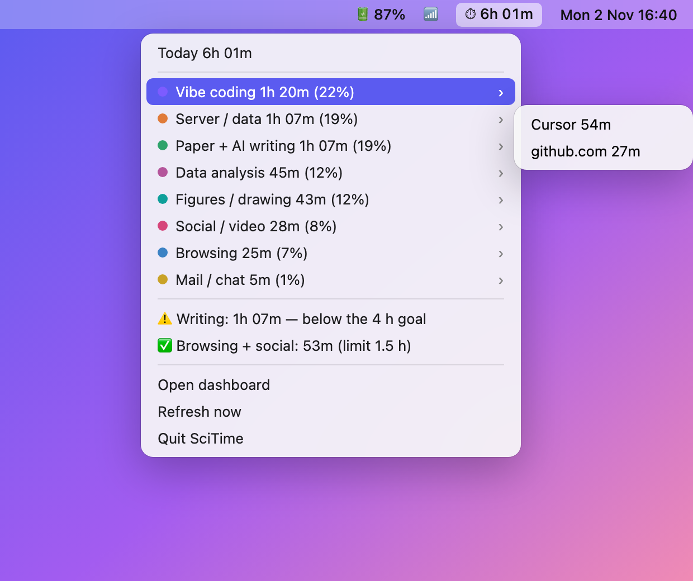
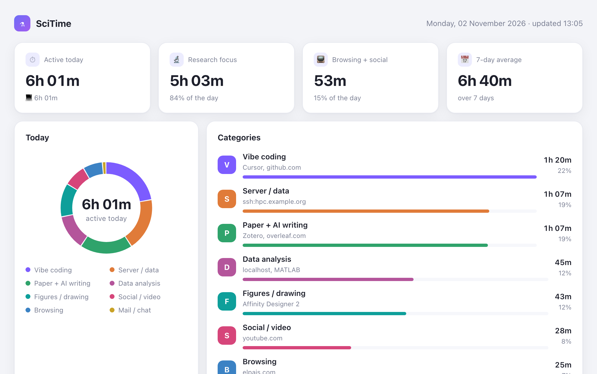

# SciTime — a scientific activity monitor

**[Website](https://yongninglei.github.io/scitime/) · [Live demo](https://yongninglei.github.io/scitime/demo.html) · [☕ Buy me a coffee](https://buymeacoffee.com/tlei)**

SciTime shows where a researcher's day actually goes: coding with AI, writing papers,
analysing data, making figures, running jobs on the cluster — or browsing and social
media. It is a productivity tool for macOS, inspired by [Tai](https://github.com/Planshit/Tai)
(a Windows screen-time app; no Tai code is used).

Every few seconds it records which app, browser tab and terminal job is in front, and
sorts the time into categories. Today's total sits in the menu bar; a dashboard shows
the day by category, hour and the last two weeks.

<p align="center">
  
</p>



<sub>Both pictures use the made-up demo data (`uv run scitime demo`), not a real person's day.</sub>

| Category | How it is recognised |
|---|---|
| **Vibe coding** | Claude desktop app, `claude`/`codex`/`aider` running in the front terminal tab, Cursor, VS Code, Zed, GitHub, claude.ai/code |
| **Paper + AI writing** | Google Docs, Overleaf, Paperpile, ChatGPT / Claude / Gemini web chat, Word, Zotero, Obsidian, PubMed/bioRxiv/journals |
| **Server / data** | an `ssh`/`mosh` session in the front terminal tab, VS Code Remote-SSH windows, Citrix Workspace, Jupyter |
| **Data analysis** | MATLAB, RStudio, JASP, SPSS, Stata, Prism, Fiji/ImageJ, FSLeyes/Freeview, local Streamlit/Shiny apps |
| **Figures / drawing** | Affinity, Illustrator, Inkscape, Figma, BioRender |
| **Browsing** | any other web page |
| **Social / video** | YouTube, Bilibili, Douyin, Instagram, X, Reddit, Xiaohongshu… |
| **Mail / chat** | Mail, Outlook, Slack, WeChat, Teams, Zoom, Gmail… |
| **Terminal (local)** | a terminal with nothing above running in it |

Time with no keyboard/mouse input for 5 minutes is not counted. Everything stays on
this Mac (`~/Library/Application Support/scitime/scitime.db`).

## Use

```bash
git clone https://github.com/yongninglei/scitime
cd scitime
uv sync
uv run scitime demo         # dashboard with made-up data, to see what it looks like
uv run scitime now          # what it sees right now — check permissions with this
uv run scitime run          # track in the foreground (Ctrl-C to stop)
uv run scitime report       # today, per category, with top sites/hosts
uv run scitime report --days 7
uv run scitime dashboard    # HTML dashboard, opens in the browser
uv run scitime bar          # today's time in the menu bar; click for categories + goals
uv run scitime install-agent  # start at login and keep running in the background
uv run scitime status
```

## Start at login + daily email

```bash
uv run scitime init           # creates ~/.config/scitime/rules.toml
# edit [digest] email = "you@…" and the [[alert]] limits in that file
uv run scitime install-agent  # tracker at login (kept alive) + digest every evening
uv run scitime digest         # preview today's digest without sending
uv run scitime digest --send  # send it now (test)
```

`install-agent` writes two launchd agents in `~/Library/LaunchAgents/`:
`io.github.yongninglei.scitime` (the tracker), `io.github.yongninglei.scitime.bar` (the menu bar item) and
`io.github.yongninglei.scitime.digest` (runs `scitime digest --send` at `[digest] time`). Re-run it after changing the time.
`scitime stop-agent` stops all three.

The digest is sent through the **Mail app** with your own account (the first send
asks for Automation permission for Mail) and has the HTML dashboard attached.

**Alerts** (`[[alert]]` in rules.toml):

- `min_hours` — e.g. writing ≥ 4 h. Checked in the evening digest.
- `max_hours` — e.g. browsing + social ≤ 1.5 h. A macOS notification appears as soon
  as the day goes over, and the digest flags it.

## Rules

`uv run scitime init` copies the rules to `~/.config/scitime/rules.toml`. Each rule is a
set of regexes over `app`, `bundle`, `title`, `url`, `domain`, `detail`; the first
matching rule wins. Rules are applied when a report is made, so editing them also
re-sorts past days. `scitime now` shows the fields for the window in front, which is
the easiest way to write a new rule.

## macOS permissions

- **Automation** (asked automatically the first time): lets scitime read the URL of the
  front Chrome/Safari/Arc tab and the tty of the front Terminal/iTerm tab.
- **Screen Recording** (optional): needed for window titles (VS Code Remote-SSH
  detection, Ghostty/WezTerm commands). `scitime now` prints which binary to add in
  System Settings → Privacy & Security → Screen & System Audio Recording.

## iPhone

iOS does not let apps read other apps' usage, so the iPhone side is a set of
Shortcuts automations (no Xcode, no developer account). Setup guide:
[docs/iphone_setup.md](docs/iphone_setup.md).

- Automations append `date,open,App` / `date,close` lines to
  `iCloud Drive/Shortcuts/scitime/phone_events.txt`.
- The Mac reads that file on every report, so iPhone time is added to the Mac time
  in reports, alerts (e.g. writing ≥ 4 h counts both) and the digest email.
- The tracker writes the combined dashboard to `iCloud Drive/Shortcuts/scitime/scitime.html`
  every 10 minutes; open it on the phone in the Files app.
- Sync is iCloud Drive only: nothing goes to any other server.
