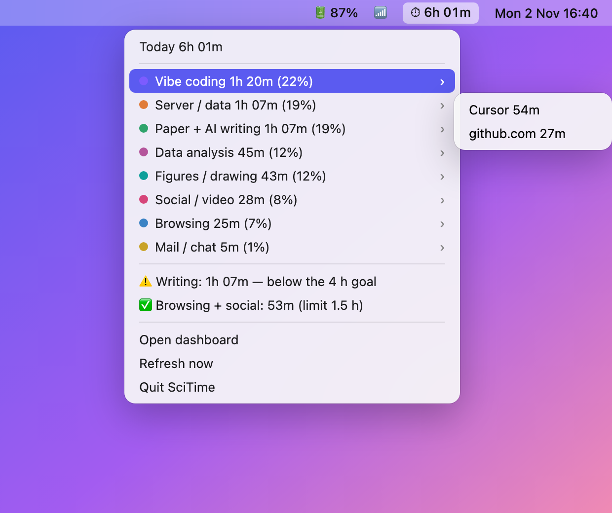
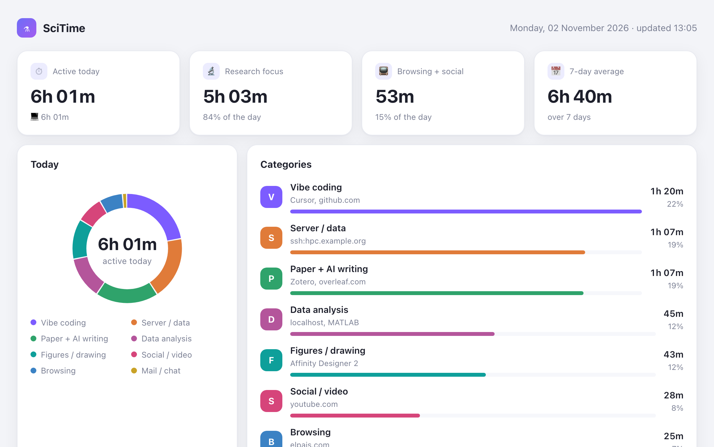

# SciTime — 科研活动监测

[English](README.md) · **中文**

**[网站](https://yongninglei.github.io/scitime/?lang=zh) · [在线演示](https://yongninglei.github.io/scitime/demo.html) · [☕ 请我喝咖啡](https://buymeacoffee.com/tlei)**

SciTime 告诉你一个科研人员的一天到底花在了哪里：用 AI 写代码、写论文、读文献、
分析数据、画图、在集群上跑任务，还是刷网页和社交媒体。它是一个 macOS 上的效率工具，
灵感来自 Windows 上的屏幕时间软件 [Tai](https://github.com/Planshit/Tai)（没有使用 Tai 的任何代码）。

它每隔几秒记录一次前台的 app、浏览器标签页和终端任务，并把时间归入不同类别。
今天的总时间显示在菜单栏；仪表盘按类别和小时展示一天的时间，还可以回到最近 30 天
里的任意一天进行回顾。

<p align="center">
  
</p>



<sub>两张图都用的是虚构的演示数据（`uv run scitime demo`），不是任何真人的一天。</sub>

| 类别 | 怎么识别 |
|---|---|
| **Vibe coding（AI 写代码）** | Claude 桌面版、前台终端里运行的 `claude`/`codex`/`aider`、Cursor、VS Code、Zed、GitHub、claude.ai/code |
| **Paper + AI writing（论文 + AI 写作）** | Google 文档、Overleaf、ChatGPT / Claude / Gemini 网页聊天、Word、Pages、Obsidian |
| **Paper reading（读文献）** | 期刊和预印本网站（ScienceDirect、Nature、Cell、eLife、Journal of Vision、PNAS、Frontiers、PLOS、Springer、Wiley、bioRxiv、arXiv、PubMed、Google Scholar、doi.org、学校图书馆代理……）、Paperpile、Zotero、ReadCube、Mendeley |
| **Server / data（服务器）** | 前台终端里的 `ssh`/`mosh` 会话、VS Code Remote-SSH 窗口、Citrix Workspace、Jupyter |
| **Data analysis（数据分析）** | MATLAB、RStudio、JASP、SPSS、Stata、Prism、Fiji/ImageJ、FSLeyes/Freeview、本地的 Streamlit/Shiny 应用 |
| **Figures / drawing（画图）** | Affinity、Illustrator、Inkscape、Figma、BioRender |
| **Browsing（浏览）** | 其他所有网页 |
| **Social / video（社交 / 视频）** | YouTube、哔哩哔哩、抖音、Instagram、X、Reddit、小红书…… |
| **Mail / chat（邮件 / 聊天）** | 邮件、Outlook、Slack、微信、Teams、Zoom、Gmail…… |
| **Terminal (local)（本地终端）** | 终端里没有运行上面任何一种任务 |

5 分钟没有键盘和鼠标操作的时间不计入。所有数据都留在这台 Mac 上
（`~/Library/Application Support/scitime/scitime.db`）。

## 使用

```bash
git clone https://github.com/yongninglei/scitime
cd scitime
uv sync
uv run scitime demo         # 用虚构数据生成仪表盘，看看效果
uv run scitime now          # 它现在看到了什么 —— 用来检查权限
uv run scitime run          # 在前台记录（Ctrl-C 停止）
uv run scitime report       # 今天的报告，按类别，附最常用的网站/主机
uv run scitime report --days 7
uv run scitime dashboard    # HTML 仪表盘，在浏览器打开；可回看最近 30 天
uv run scitime bar          # 菜单栏显示今天的时间；点开看各类别和目标
uv run scitime install-agent  # 开机登录后自动启动，并在后台一直运行
uv run scitime status
```

## 开机启动 + 每日邮件

```bash
uv run scitime init           # 生成 ~/.config/scitime/rules.toml
# 在这个文件里填 [digest] email = "you@…"，并修改 [[alert]] 的时间上下限
uv run scitime install-agent  # 登录时启动记录程序（保持运行）+ 每晚发送日报
uv run scitime digest         # 预览今天的日报，不发送
uv run scitime digest --send  # 现在发送一次（测试）
```

`install-agent` 会在 `~/Library/LaunchAgents/` 写入三个 launchd agent：
`io.github.yongninglei.scitime`（记录程序）、`io.github.yongninglei.scitime.bar`（菜单栏）和
`io.github.yongninglei.scitime.digest`（在 `[digest] time` 运行 `scitime digest --send`）。
改了时间之后要重新运行一次。`scitime stop-agent` 会停掉这三个。

日报通过 **「邮件」app** 用你自己的账号发送（第一次发送时会请求「邮件」的自动化权限），
附件是 HTML 仪表盘。

**提醒**（rules.toml 里的 `[[alert]]`）：

- `min_hours` —— 比如写作 ≥ 4 小时。在晚上的日报里检查。
- `max_hours` —— 比如浏览 + 社交 ≤ 1.5 小时。一超过就弹出 macOS 通知，日报里也会标出来。

## 自定义网站和类别

最简单的方法是在 `~/.config/scitime/sites.yaml` 里，把网站列在已有的类别下面：

```yaml
paper_reading:
  - jov.arvojournals.org     # 包括它的子域名
  - journals.plos.org
vibe_coding:
  - github.com/my-lab        # 只算这个路径下的页面
```

也可以让命令帮你写：

```bash
uv run scitime add-site paper_reading jov.arvojournals.org journals.plos.org
uv run scitime sites                                        # 看 sites.yaml 里有什么
```

这里列出的网站优先于所有内置规则。要新建类别、给 app 分类或写正则规则：

```bash
uv run scitime categories                                   # 现有的类别
uv run scitime add-category grant_writing --label "Grant writing" --focus
uv run scitime add-rule grant_writing --domain erc.europa.eu
uv run scitime add-rule paper_reading --app "Skim|PDF Expert"
uv run scitime which --url https://erc.europa.eu/apply      # → Grant writing
```

你的规则排在内置规则前面，所以优先生效。每次修改都会先检查，旧文件保存为
`rules.toml.bak`。规则在生成报告时才应用，所以过去的日子也会重新归类。

**也可以让 AI 帮你设置。** 用 Claude Code、Codex 等工具打开这个文件夹，直接说，比如
*「把 jov.arvojournals.org 和 journals.plos.org 算作读文献」*，或者
*「新建一个 Grant writing 类别，包含 ERC 的网站，算作专注时间」*。
完整说明见 [docs/custom_categories.zh-CN.md](docs/custom_categories.zh-CN.md)，写给你也写给你的 AI，
包括所有字段、例子、手动编辑方法，以及 AI 不许读取你的使用记录这条规则。
[AGENTS.md](AGENTS.md) 会把 AI 助手引到这份说明。

规则在 `~/.config/scitime/rules.toml`（由 `uv run scitime init` 生成）。每条规则是对
`app`、`bundle`、`title`、`url`、`domain`、`detail` 的一组正则表达式，第一条匹配上的规则生效。

## macOS 权限

- **自动化**（第一次会自动询问）：让 scitime 读取前台 Chrome/Safari/Arc 标签页的网址，
  以及前台 Terminal/iTerm 标签页的 tty。
- **录屏**（可选）：读取窗口标题需要它（识别 VS Code Remote-SSH、Ghostty/WezTerm 里的命令）。
  `scitime now` 会告诉你要在「系统设置 → 隐私与安全性 → 录屏与系统录音」里添加哪个程序。

## iPhone

iOS 不允许 app 读取其他 app 的使用时间，所以 iPhone 端用的是一组「快捷指令」自动化
（不需要 Xcode，也不需要开发者账号）。设置步骤：
[docs/iphone_setup.zh-CN.md](docs/iphone_setup.zh-CN.md)。

- 自动化会往 `iCloud 云盘/快捷指令/scitime/phone_events.txt` 追加
  `日期,open,App` / `日期,close` 这样的行。
- Mac 每次生成报告时都会读这个文件，所以手机时间会加到电脑时间里，报告、提醒
  （比如写作 ≥ 4 小时会把两边都算上）和日报邮件都包括它。
- 记录程序每 10 分钟把合并后的仪表盘写到 `iCloud 云盘/快捷指令/scitime/scitime.html`，
  在手机的「文件」app 里打开即可。
- 同步只经过 iCloud 云盘，不会发送到任何其他服务器。
